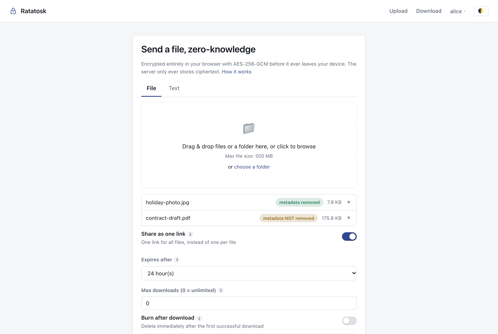
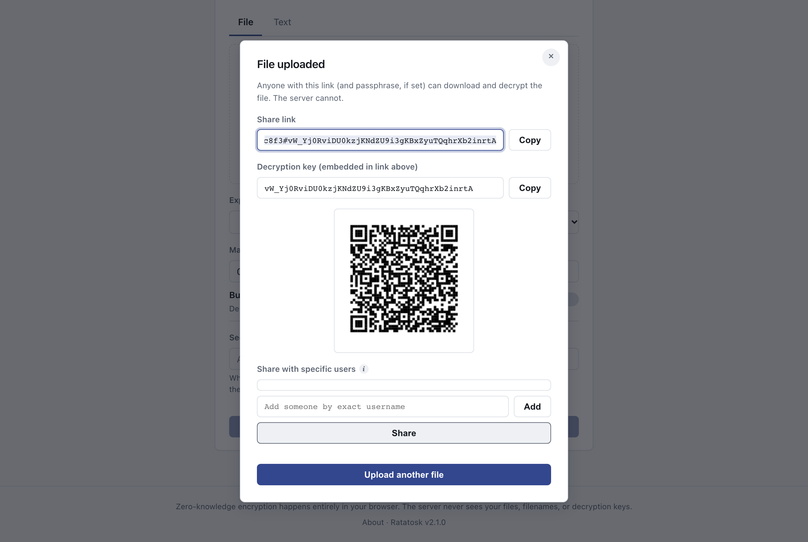
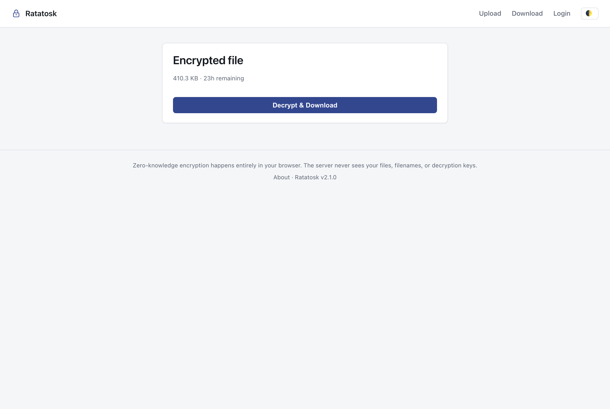
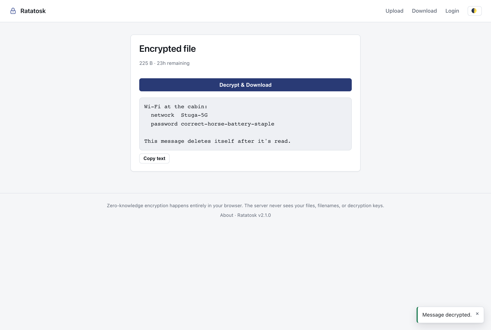
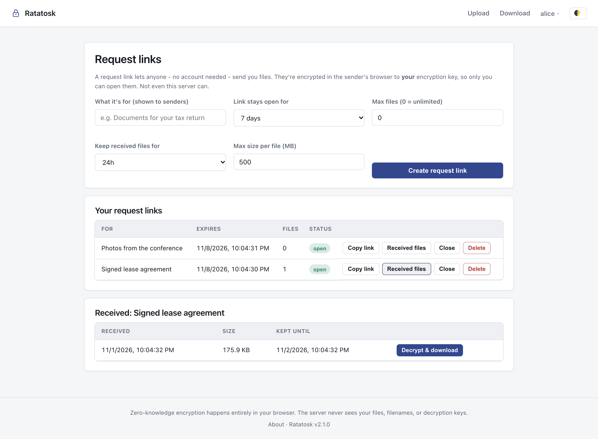
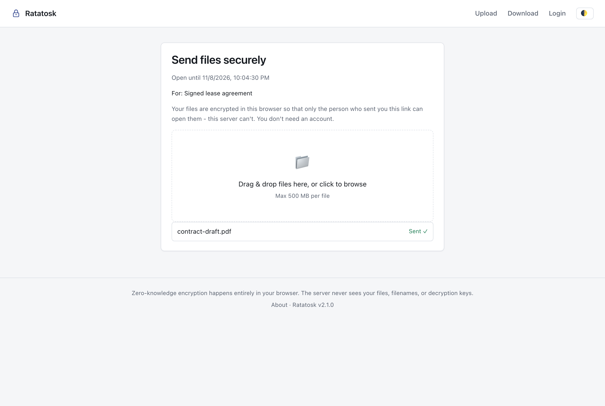
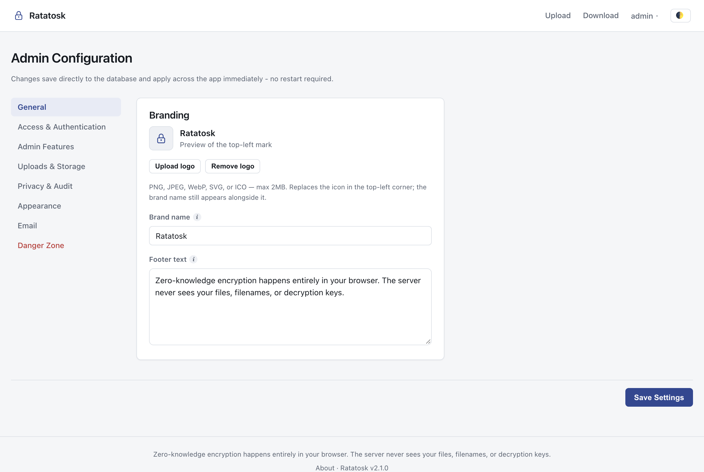
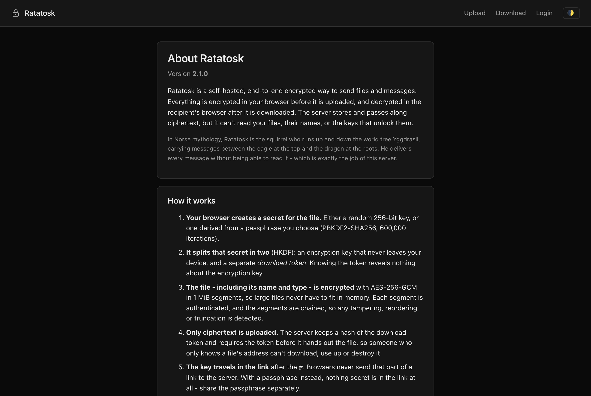

# Ratatosk

**Self-hosted, end-to-end encrypted file and message sharing.** Files are encrypted in the browser before upload and decrypted in the recipient's browser after download, with the Web Crypto API (AES-256-GCM). The server stores and serves ciphertext only: it never sees file contents, filenames, keys or passphrases.

> In Norse mythology, Ratatosk is the squirrel who runs up and down the world tree Yggdrasil carrying messages between the eagle and the dragon, delivering every message without being able to read it. That's this server's job.

*Formerly "SecureDrop". Renamed in 2.0 to avoid confusion with the Freedom of the Press Foundation's whistleblower platform of that name. See [CHANGELOG.md](CHANGELOG.md).*

**Current version:** 2.1.0 (see [Versioning](#versioning)).

- **Zero-knowledge:** link keys travel in the URL `#fragment`, which browsers never send. Passphrases never leave the browser at all: the server only checks a token derived from them, which can't decrypt anything.
- **Built for large files:** streaming, segmented encryption keeps memory flat in both directions. Uploads resume after a dropped connection or a page reload, and big downloads stream straight to disk.
- **Privacy-first operation:** zero-log mode, IP masking, timestamp fuzzing, and lossless removal of location and author metadata from photos. No third-party scripts, fonts or trackers, so it's safe on an onion service.
- **People can send you files, too:** a **request link** lets anyone, with no account needed, upload files that are encrypted to *your* key, so only you can open them.
- **Account-to-account sharing is end-to-end:** each user can have their own encryption keypair, so shares between accounts are unreadable to the server.
- **Operator controls:** every policy is editable live at `/admin/settings`. There's also an audit log, user and file management, two-factor authentication (optionally mandatory), **single sign-on (OIDC)**, scoped API keys and a CLI.
- **Verifiable:** every script is pinned by hash, and `ratatosk verify` checks a live server against the published release.

---

## Screenshots

| | |
|---|---|
|  |  |
| **Upload:** files are encrypted in the browser. Each file shows whether its location and author metadata was removed. | **Share link:** the decryption key is in the part after `#`, which never reaches the server. |
|  |  |
| **Download:** the recipient's browser checks the key, then downloads and decrypts. | **Text messages:** shown in the browser, with nothing to download. |
|  |  |
| **Request links:** anyone can send you files that only you can open. | **Sending through a request link:** no account needed. |
|  |  |
| **Admin settings:** every policy is editable live. | **About page** (dark theme): how it works, the trust model, license and version. |

*Screenshots come from a throwaway demo instance with made-up users and files. Regenerate them with `python docs/screenshots/capture.py`.*

---

## Contents

- [Screenshots](#screenshots)
- [Features](#features)
- [How the encryption works](#how-the-encryption-works)
- [What you have to trust](#what-you-have-to-trust)
- [Quick start](#quick-start)
- [Running with Docker](#running-with-docker)
- [Running as a Tor onion service](#running-as-a-tor-onion-service)
- [Configuration](#configuration)
- [Command-line client](#command-line-client)
- [Using it](#using-it)
- [API overview](#api-overview)
- [Development](#development)
- [Versioning](#versioning)
- [Upgrading from SecureDrop 1.x](#upgrading-from-securedrop-1x)
- [Project structure](#project-structure)
- [License](#license)

---

## Features

**Sending**
- Files of any size (up to the admin's limit), multiple files or whole folders, either one link per file or **several files behind one link**.
- **Encrypted text messages**, shown in the recipient's browser with nothing to download.
- Expiry presets, download limits, **burn after download**, and an optional **passphrase** as a second, out-of-band secret.
- **Resumable uploads**: interrupted uploads continue where they stopped, including after a reload. Failed chunks retry automatically, and there's a Cancel button.
- **Metadata removal**: JPEG, PNG and WebP are cleaned losslessly at the container level. Pixels are never re-encoded, and orientation and colour profiles are kept. Formats that can carry metadata the browser can't remove (HEIC, video, PDF, Office documents) are clearly flagged, and the sender must confirm before uploading them.
- QR code for every share link.

**Receiving**
- Download progress, and confirmation before a single-use file is destroyed.
- The key or passphrase is **checked before anything is consumed**, so a mistyped passphrase or a truncated link never burns a file.
- Large files **stream directly to disk** through a service worker instead of filling memory.

**Accounts** (optional; anonymous use can stay enabled)
- "My Files" with **link management**: switch a link off and on, expire it now, lower its download limit, or unlock it after failed passphrase guesses.
- **Two-factor authentication (TOTP)**: codes are single-use, backup codes are provided, and admins can make it mandatory per role.
- **End-to-end encryption keys**: set up a keypair under Profile, protected by an *encryption passphrase* that never leaves your browser (deliberately separate from the login password). Unlocked keys can be remembered per device as non-extractable keys until logout.
- **User-to-user sharing**: share with other accounts, who open the file just by signing in. For recipients with keys this is end-to-end: the file key is wrapped to their public key, and the server can't open it. For recipients without keys, the site can fall back to a server-held key (admin setting, and the dialog warns you). The directory of users is opt-in, and anyone can be added by exact username.
- **Request links** (`/requests`): create a "send me files" link with a description, expiry, file-count limit and retention. Anyone with the link can send files with no account needed. The link carries your key's fingerprint, so the sender's browser refuses to encrypt if the server ever substituted a different key. Received files appear only in your inbox.
- **Single sign-on** with any OpenID Connect provider (Keycloak, Authentik, Entra ID, Google, Okta and others): authorization code flow with PKCE, optional admin-group mapping and opt-in linking by verified email.
- **API keys** (full or upload-only) for the [CLI](#command-line-client) and scripts.
- Download notifications by email. These describe size and time only, since the server never knows the filename.

**Operators**
- Every policy is editable at runtime and applies to every server process within a second.
- Audit log with filters and CSV/JSON export, respecting the configured privacy level. Retention is applied automatically, and pruning is itself always recorded.
- Statistics, user and file management, branding (logo, name, footer, colour theme), and a factory reset.
- Abuse protection:
  - per-network rate limiting
  - brute-force limits that hold under parallel requests
  - login lockouts that only affect the guessing network, so nobody can lock the admin out
  - a storage cap that accounts for uploads in progress
  - a server-wide cap on active uploads
- Local-disk or S3-compatible storage (AWS S3, MinIO, Backblaze B2 and others).

**Deliberately not included:** server-side virus scanning. A server that can scan files can read them, so it's incompatible with zero-knowledge. Treat files from strangers with the usual care.

---

## How the encryption works

1. **One secret per file.** In link mode the browser generates a random 256-bit secret. In passphrase mode the secret is `PBKDF2-SHA256(passphrase, random salt, 600,000 iterations)`, which is OWASP's current recommendation. The iteration count is stored per file, so it can be raised later.
2. **The secret is split with HKDF-SHA256** into two independent values:
   - the **AES-256-GCM file key**, which never leaves the browser;
   - a **download token**. The server stores `SHA-256(token)` and requires the token before it serves the ciphertext.

   Knowing the token reveals nothing about the file key. So the server can check that a downloader holds the secret without ever being able to decrypt. This is the same idea Firefox Send used.
3. **The envelope** (`{name, type, size}` plus the file bytes) is encrypted in **1 MiB segments** using the STREAM construction:
   - each segment's IV includes its index, so segments can't be reordered;
   - each segment is authenticated with the header and a "final segment" flag, so it can't be truncated or have its header swapped.
4. **Only ciphertext is uploaded**, chunk by chunk as it's produced, with each chunk addressed by its byte offset. Retries are therefore harmless, and an interrupted upload can resume anywhere, because the ciphertext is a pure function of the key, nonce and plaintext.
5. **Link mode:** the secret goes in the link after `#`. **Passphrase mode:** nothing secret is in the link. Share the passphrase separately.
6. **Download:** the browser derives the token, checks it with the server, then decrypts the segments as they arrive.

The full byte-level format is documented at the top of [`frontend/static/js/crypto.js`](frontend/static/js/crypto.js). The CLI implements it byte-for-byte, and a test checks that the two interoperate. Files uploaded with every earlier format still decrypt.

## What you have to trust

- **The code your browser runs comes from the server.** An operator who wanted to (or was compelled to) could serve modified JavaScript that captures keys. This is inherent to all browser-based encryption. Ratatosk makes it **detectable**: every script and stylesheet is pinned with Subresource Integrity, and `ratatosk verify https://server --expect <digest>` checks, from your own machine, that the server serves exactly the release whose digest is published in [CHANGELOG.md](CHANGELOG.md). For the highest assurance, use the CLI, which encrypts locally and runs no server-supplied code.
- **Metadata the server does see:** encrypted file sizes, upload and download times, the declared file extension (used for allow/deny rules), and network addresses, unless the operator enables zero-log mode or IP masking.
- **User-to-user sharing** is end-to-end when the recipient has encryption keys. Only shares to recipients *without* keys store that file's key on the server, if the admin allows it. The key is released as soon as no such share needs it. Link, passphrase and request-link sharing never store keys.
- **Sessions** use an HttpOnly, `SameSite=Strict` cookie that page scripts can't read, and state-changing requests need a CSRF header. API clients use bearer tokens.
- Serve it over **HTTPS** (or as an onion service). HSTS is sent automatically on HTTPS, along with a strict Content-Security-Policy that only allows scripts from the site itself.

The project has had an internal engineering audit ([docs/AUDIT.md](docs/AUDIT.md)) but **no independent professional security audit**. Review it before relying on it for high-risk use.

---

## Quick start

Requires **Python 3.11+**.

```bash
python -m venv .venv
source .venv/bin/activate            # Windows: .venv\Scripts\activate
pip install -r requirements.txt

cp .env.example .env                 # then set RATATOSK_SECRET_KEY:
python -c "import secrets; print(secrets.token_hex(32))"

python -m app.init_db                # runs migrations, prints a one-time admin password
uvicorn app.main:app --host 127.0.0.1 --port 8000
```

Open http://127.0.0.1:8000 and sign in at `/login` with the printed admin credentials. The first admin login opens a short setup wizard.

If every admin is ever locked out: `python -m app.unlock <username>` (or `--all`).

## Running with Docker

```bash
cp .env.example .env    # set RATATOSK_SECRET_KEY
docker compose up -d --build
docker compose logs ratatosk | grep -A3 "Created default admin"
```

The image runs as a non-root user on a read-only filesystem, installs hash-verified dependencies (`requirements.lock`) on a digest-pinned base image, and has a health check. Data lives in `./data` (database) and `./storage` (encrypted blobs).

Behind a reverse proxy, terminate TLS there and set `FORWARDED_ALLOW_IPS` to the proxy's address, so the app knows requests arrived over HTTPS. Allow request bodies of at least the configured chunk size (5 MB by default).

## Running as a Tor onion service

```bash
docker compose --profile tor up -d --build
docker compose exec tor cat /var/lib/tor/ratatosk/hostname
```

Enter that address under **Admin Settings → Tor onion address**. Pages served on the regular domain then advertise it with an `Onion-Location` header, so Tor Browser offers to switch. See [docs/TOR.md](docs/TOR.md) for details and hardening tips.

---

## Configuration

Two layers: **environment variables** for what's needed before the database is available or must never be web-editable, and **runtime settings** in the admin panel for everything else.

### Environment variables

Prefix `RATATOSK_`, set directly or in `.env`. Older `SECUREDROP_*` names still work, with a deprecation warning.

| Variable | Default | Description |
|---|---|---|
| `RATATOSK_SECRET_KEY` | *(none; required)* | Signs session tokens. The app refuses to start with the placeholder. |
| `RATATOSK_DATABASE_URL` | `sqlite:///./ratatosk.db` | SQLAlchemy URL. An existing `securedrop.db` is picked up automatically. |
| `RATATOSK_STORAGE_ROOT` | `./storage/encrypted` | Where encrypted blobs are written (local backend). Deliberately not editable in the web UI. |
| `RATATOSK_TMP_ROOT` | `./storage/tmp` | Staging for uploads in progress (always local). |
| `RATATOSK_BRANDING_ROOT` | `./storage/branding` | Uploaded logo. |
| `RATATOSK_JWT_EXPIRE_MINUTES` | `720` | Session lifetime. Logout revokes a session immediately. |
| `RATATOSK_DEFAULT_ADMIN_USERNAME` / `_PASSWORD` | `admin` / *random* | First admin, created by `init_db`. |
| `RATATOSK_OIDC_ISSUER`, `_CLIENT_ID`, `_CLIENT_SECRET` | *(unset)* | Enable single sign-on. Register `<site>/api/auth/oidc/callback` as the redirect URL at your provider (override with `RATATOSK_OIDC_REDIRECT_URL`). |
| `RATATOSK_OIDC_ADMIN_GROUP` / `_GROUPS_CLAIM` | *(unset)* / `groups` | Members of this group are admins, re-checked at every SSO login. The last admin is never demoted. |
| `RATATOSK_OIDC_AUTO_PROVISION` / `_LINK_BY_EMAIL` | `true` / `false` | Create accounts on first SSO login; link to an existing local account with the same verified email (off by default, because whoever controls the provider could otherwise take over local accounts). |
| `RATATOSK_OIDC_SCOPES` / `_BUTTON_LABEL` | `openid email profile` / `Sign in with SSO` | |
| `RATATOSK_STORAGE_BACKEND` | `local` | `local` or `s3`. For `s3`: `RATATOSK_S3_BUCKET`, `_REGION`, `_ENDPOINT_URL`, `_ACCESS_KEY_ID`, `_SECRET_ACCESS_KEY`, `_PREFIX`; also run `pip install -r requirements-s3.txt`. |

### Runtime settings (admin panel)

At **`/admin/settings`**, changes apply immediately to every server process.

| Section | Settings |
|---|---|
| Access | Anonymous upload / download, registration, user login, secondary passphrase (allow / enforce), user-to-user sharing (and whether recipients without keys may get server-held keys), request links, API keys, multi-file upload |
| Two-factor | Enable; enforce for users; enforce for admins |
| Login security | Rate limiting, lockout duration, max attempts (logins and file passphrases) |
| Abuse limits | Per-network requests per minute; max concurrent uploads per uploader; max uploads in progress server-wide |
| Password policy | Minimum length (8+), required character classes |
| Uploads | Max file size, chunk size (1-64 MB), extension allow/deny list |
| Retention | TTL presets and default, custom expiry on/off, burn after download (allow/force), download limits |
| Storage | Storage cap (rejects uploads above 95%), cleanup interval; storage location shown read-only |
| Privacy | Zero-log mode, IP masking (`none` / `masked` / `full`), timestamp fuzzing |
| Audit | Retention in days (applied automatically), disable audit log |
| Email | SMTP settings, password-reset emails, download notifications, test email |
| Tor | Onion address for the `Onion-Location` header |
| Branding | Logo, name, footer text, custom colour theme, hide nav links |

Every numeric setting is validated with bounds, so a typo can't take the service down.

---

## Command-line client

`cli/ratatosk.py` uses the same encryption as the browser, so the server never sees plaintext or keys. It needs `pip install cryptography`.

```bash
export RATATOSK_API_KEY=sdk_...                   # create one at /account (Upload-only is enough to upload)
python cli/ratatosk.py upload --server https://drop.example.com --ttl 7d report.pdf
python cli/ratatosk.py upload --server https://drop.example.com --password 'long passphrase' --burn secrets.zip
tar cz project/ | python cli/ratatosk.py upload --server https://drop.example.com --stdin --name project.tgz

python cli/ratatosk.py download 'https://drop.example.com/share/<id>#<key>'
python cli/ratatosk.py download 'https://drop.example.com/share/<id>' --password '...' -o out.pdf
python cli/ratatosk.py verify https://drop.example.com --expect <release digest from CHANGELOG.md>
python cli/ratatosk.py --version                  # add --json to any command for machine-readable output
```

The old `cli/securedrop_upload.py` still works as an alias for `ratatosk.py upload`.

## Using it

- **Upload** (`/`): choose File or Text, then set expiry, download limit, burn-after-download or a passphrase. With several files selected, "Share as one link" bundles them. Each file shows whether its metadata was removed.
- **Download:** open the link. Without a full link, use `/download` with the file ID and key or passphrase.
- **My Files** (`/files`): manage your links and shares.
- **Profile** (`/account`): password, email, two-factor authentication, **encryption keys**, API keys, sharing-directory visibility, and account deletion (needs your password, or your username for SSO accounts; the last admin can't delete themselves).
- **Request links** (`/requests`): create links, copy them, close them, and open what people sent you.
- **About** (`/about`): how it works, the trust model, license and version.

## API overview

Everything is under `/api`. Interactive docs are at `/docs`.

| Endpoint | Purpose |
|---|---|
| `POST /api/auth/register`, `/login`, `/logout`, `GET /api/auth/me` | Accounts. Login and register return a session, an MFA challenge, or a mandatory-MFA-setup step. |
| `POST /api/auth/mfa/{setup,confirm,verify,enforce-setup,enforce-confirm,disable}` | Two-factor authentication (`disable` needs password plus a current code). |
| `POST /api/auth/change-password`, `/logout-everywhere`, `PATCH /api/auth/email`, `/discoverable`, `DELETE /api/auth/me` | Self-service |
| `GET /api/config`, `GET /api/health` | Public policy subset (includes `version`); health check |
| `POST /api/uploads/init` → `PUT /api/uploads/{id}/chunk` (header `Upload-Offset`) → `POST /api/uploads/{id}/complete` | Upload. Also `GET /api/uploads/{id}` (resume offset) and `DELETE` (cancel). |
| `GET /api/files/{id}/meta`, `POST /api/files/{id}/verify-token`, `GET /api/files/{id}/blob` (header `X-Download-Token`) | Download |
| `GET /api/files/mine`, `PATCH /api/files/{id}`, `POST /api/files/{id}/unlock`, `DELETE /api/files/{id}` | Owner file management |
| `GET /api/users/list`, `GET /api/users/lookup`, `POST /api/files/{id}/share`, `GET /api/files/shared-with-me`, `GET /api/files/{id}/shared-key`, `DELETE /api/files/{id}/share/{recipient}` | User-to-user sharing |
| `/api/admin/settings`, `/audit`, `/users`, `/files`, `/stats`, `/branding/logo`, `/system/reset` | Administration (admin only) |
| `GET/POST /api/account/api-keys`, `DELETE /api/account/api-keys/{id}` | API keys |
| `GET/PUT /api/account/keys`, `GET /api/users/{id}/public-key` | End-to-end encryption keys (the private key is always passphrase-wrapped) |
| `POST/GET /api/requests`, `POST /api/requests/{id}/close`, `DELETE /api/requests/{id}`, `GET /api/requests/{id}/files`, `GET /api/requests/{id}/public` | Request links (`/public` needs no account) |
| `GET /api/auth/oidc/login`, `/callback` | Single sign-on |
| `GET /api/integrity` | Hashes of every frontend file plus the release digest |

---

## Development

```bash
pip install -r requirements-dev.txt
python -m playwright install chromium        # for the browser tests
npm install                                  # for eslint (dev only; nothing is shipped)

pytest -q --ignore=tests/e2e                 # unit and API tests
pytest -q tests/e2e                          # real-browser and live-server concurrency tests
node --test "tests/js/*.test.mjs"           # crypto, metadata stripping, CLI <-> browser interop

ruff check app cli tests migrations/env.py   # lint
mypy app cli                                 # types
bandit -c pyproject.toml -r app cli          # security lint
pip-audit -r requirements.txt                # known-vulnerable dependencies
npx eslint frontend/static/js tests/js       # JS lint incl. XSS sinks
```

CI runs all of the above ([.github/workflows/ci.yml](.github/workflows/ci.yml)). Tests use throwaway databases and storage, and never touch your real data.

**Frontend changes:** after editing any JS or CSS, run `python -m app.integrity write` to refresh the Subresource Integrity hashes. A test fails if you forget. At release time, record `python -m app.integrity digest` in the changelog.

**Schema changes** go through Alembic. Change a model, then run `alembic revision --autogenerate -m "what changed"`, review the file, and the app applies it on start. Databases created before Alembic are brought to the baseline and stamped automatically.

**Dependencies:** edit `requirements.txt`, then regenerate the lock with `uv pip compile requirements.txt --generate-hashes -o requirements.lock`.

## Versioning

Ratatosk follows [Semantic Versioning](https://semver.org): **MAJOR** for incompatible changes (file format, API, configuration), **MINOR** for features, **PATCH** for fixes.

- The version lives in [`app/version.py`](app/version.py), and the CLI carries the same number (a test keeps them equal).
- It's shown on the About page, in every page footer, by `GET /api/health`, and by `ratatosk --version`.
- Every release is recorded in [CHANGELOG.md](CHANGELOG.md). To release, add the entries under a new version heading, bump both version strings, and tag the commit `vX.Y.Z`.

## Backups

The database runs in SQLite WAL mode, so **don't copy the `.db` file while the server runs**: recent changes live in the `-wal` file, and a plain copy can be stale or inconsistent. Use SQLite's backup command instead, plus a copy of the storage directory:

```bash
sqlite3 ratatosk.db ".backup 'backup-$(date +%F).db'"     # or securedrop.db on upgraded installs
rsync -a storage/ backup-storage/
```

## Upgrading to 2.1

Everyone signs in once more after upgrading: sessions moved from browser storage into a secure cookie. Nothing else changes for existing users. Encryption keys, request links and SSO are opt-in.

## Upgrading from SecureDrop 1.x

Start 2.0 against your existing data. The database is migrated on first start, existing `SECUREDROP_*` settings keep working (rename them to `RATATOSK_*` when convenient), and every previously uploaded file still decrypts. Two things change for existing users:
- **Old CLI versions can't upload with a passphrase any more.** The server refuses to receive passphrases. Use `cli/ratatosk.py`.
- **The sharing directory is now opt-in.** Users who want to appear in the share picker can turn that on under Profile.

## Project structure

```
app/
  api/            FastAPI routers (auth, uploads, files, sharing, admin, config, API keys)
  core/           config, database (UTC-aware types, SQLite WAL), security (JWT, TOTP), settings cache,
                  rate limiting, cleanup worker, migrations runner, privacy helpers
  models/         SQLAlchemy models, incl. ops.py (throttles, revocations, deletion queue, leases, chunks)
  schemas/        Pydantic schemas (settings schemas generated from the model)
  services/       lockout, users, files, session policy, storage (local/S3), audit, email
  init_db.py      migrations plus first admin;  unlock.py  out-of-band unlock;  version.py
cli/ratatosk.py   command-line client
frontend/         HTML pages and static/js (crypto.js, exif-strip.js, upload/download flows, sw.js, admin UIs)
migrations/       Alembic revisions
deploy/tor/       Tor onion-service sidecar
docs/             AUDIT.md (engineering audit and status), TOR.md
tests/            pytest (API, S3, privacy, policy), tests/e2e (Playwright and concurrency), tests/js (node --test)
```

## License

[MIT](LICENSE). Copyright © 2026 Johan Zetterström.
